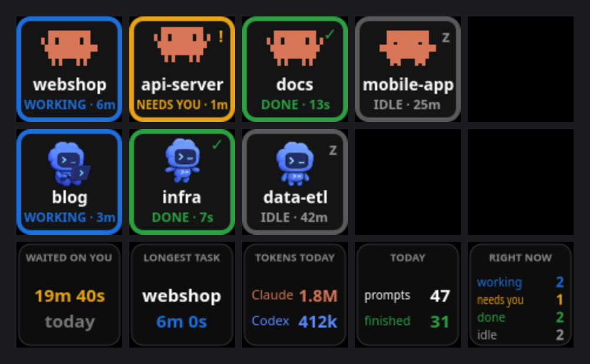
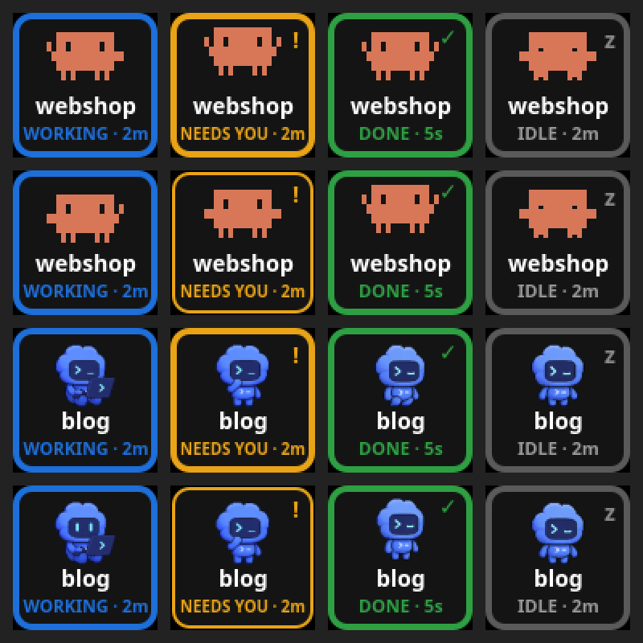

# Loupedeck Agent Board

Turn a **Loupedeck Live S** into a live status board for your **Claude Code** and **Codex** terminal sessions on Linux.

See at a glance which agent is working, which one needs you, and which one is done — then press its key to jump straight to that terminal tab.



## Features

- **One key per session.** Claude Code sessions on the top row, Codex sessions on the middle row.
- **Status at a glance.** Each key shows the project folder, its status, and for how long.
- **Animated mascots.** The Claude Code mascot and the Codex pet act out the status: typing while working, waving when they need you, cheering when done, sleeping when idle.
- **Press a key to jump** to that exact Tilix tab.
- **Stats row:** what's happening right now, prompts and finished tasks today, tokens used today (Claude and Codex), the longest running task, and how long agents waited on you.
- **Hardware buttons:** open a new Claude or Codex tab, jump to whoever has waited longest, and a hold-to-confirm **kill switch** that ends every agent session (your tabs stay open).
- **Startup animation** whenever the board connects.
- Starts automatically at login, survives unplugging, and never slows your agents down.

| Working | Needs you | Done | Idle |
|:---:|:---:|:---:|:---:|
| blue | pulsing amber | green, then gray once visited | gray |




## Requirements

| | |
|---|---|
| Device | Loupedeck **Live S** (other Loupedeck models are not supported yet) |
| OS | Linux. Tested on Ubuntu with GNOME on Wayland |
| Terminal | **[Tilix](https://gnunn1.github.io/tilix-web/)** for jumping to tabs and opening new ones. Sessions in other terminals still show up, but can't be jumped to (marked ⊘) |
| Node.js | 20 or newer |
| Agents | [Claude Code](https://docs.claude.com/en/docs/claude-code) and/or [Codex CLI](https://github.com/openai/codex) |
| Tools | `curl`, `gdbus` (preinstalled on GNOME), `sudo` once for the device permission |

> **Loupedeck firmware:** the underlying [`loupedeck`](https://github.com/foxxyz/loupedeck) library reports that firmware 0.2.26 does not work on Linux. Tested here with firmware 0.1.4.

## Install

```bash
git clone https://github.com/pira12/loupedeck-agent-board.git
cd loupedeck-agent-board
./install.sh
```

Run it as your normal user (not with `sudo`). The installer:

1. Adds a udev rule so your user can open the Loupedeck (asks for `sudo` once).
2. Installs the Node dependencies.
3. Downloads the Codex pet artwork from OpenAI's CDN (it is not shipped in this repo).
4. Adds hooks to `~/.claude/settings.json` and `~/.codex/hooks.json` (both are backed up first).
5. Installs and starts a systemd user service, `loupedeck-claude`, that starts at every login.

**Codex only:** open Codex once and run `/hooks` to trust the new hooks. Codex skips hooks until you approve them.

Sessions that were already running appear after their next prompt. Codex terminals appear within a couple of seconds.

To remove everything: `./install.sh --uninstall` (the udev rule is left in place; the command tells you how to remove it).

## Controls

```
  ◯ top dial ........ page through sessions (when a row has more than 5)
  ◯ lower dial ...... brightness
  ● under the dials . KILL ALL: hold 2 s (keys count down in red, release to cancel)

                      ● top right ...... new Claude tab   (orange)
                      ● middle right ... new Codex tab    (blue)
                      ● bottom right ... jump to the session that has waited longest
                                         (lights amber when someone is waiting)
```

- **Touch a session key** to jump to its terminal. A green "done" key turns gray once you've visited it.
- **New tabs** open in the folder of the session you last jumped to (or your home folder) and drop you into a shell when the agent exits.
- **Kill all** sends a polite stop signal to every Claude and Codex session on the board, then force-stops any that are still running 5 seconds later. It double-checks each process is really `claude` or `codex` first. Tabs stay open at a shell prompt, so you can resume with `claude --continue` or `codex resume`.
- **Touch anything during the startup animation** to skip it.

## How it works

```
Claude Code ──hooks──┐
                     ├──► hooks/hook.sh ──HTTP──► service (127.0.0.1:47800) ──USB──► Loupedeck
Codex CLI ───hooks───┘                                 │
                          /proc scan (Codex terminals) ┤
                          transcripts (token counts) ──┘
                                                       └──gdbus──► Tilix: focus tab / open tab
```

- **Hooks** (`SessionStart`, `UserPromptSubmit`, `PreToolUse`, `Notification` / `PermissionRequest`, `Stop`, `SessionEnd`) run `hooks/hook.sh`. It posts the event to the local service with a 1-second timeout and always exits successfully, so a stopped service never blocks an agent.
- **Codex** runs its hooks in a shared background server, so a hook can't tell which terminal it belongs to. The service finds Codex terminals itself by scanning running processes, then links hook events to them by folder.
- **Jumping** uses Tilix's D-Bus action `activate-terminal` with the terminal's `TILIX_ID`.
- **Token counts** come from the agents' own transcripts (`~/.claude/projects`, `~/.codex/sessions`): new input + output tokens today. Cache reads are left out because they re-count the whole conversation on every message.
- **Nothing leaves your machine.** The service only listens on `127.0.0.1`.

State is kept in `~/.local/state/loupedeck-claude/sessions.json`, so a restart keeps the board.

## Troubleshooting

| Problem | Try |
|---|---|
| Board stays dark | `journalctl --user -u loupedeck-claude -f` for the log. "Permission denied" means the udev rule isn't active yet: unplug and replug the Loupedeck. |
| A session doesn't appear | Claude: send a prompt. Codex: run `/hooks` in Codex and trust the hooks. Check `curl -s 127.0.0.1:47800/sessions`. |
| Pressing a key doesn't switch tabs | Only works for Tilix terminals. Keys marked ⊘ were started elsewhere. |
| Codex sessions show the Claude mascot | The Codex artwork wasn't downloaded: `npm run fetch-pets`. |
| Service won't start after a Node upgrade | The service runs the Node it was installed with. Run `./install.sh` again. |

Service commands: `systemctl --user status|restart|stop loupedeck-claude`.

## Development

```bash
npm test                                         # unit tests (node:test, no device needed)
node src/main.js                                 # run in the foreground (stop the service first)
node scripts/board-preview.mjs --demo board.png  # render the board without a device
node scripts/preview.mjs keys.png                # every key state
node scripts/intro-preview.mjs intro.png         # frames of the startup animation
node scripts/intro-gif.mjs intro.gif             # the startup animation as a GIF
```

| Path | What it does |
|---|---|
| `src/main.js` | Wires everything together |
| `src/store.js` | Sessions, status changes, daily stats |
| `src/board.js` | Device input, layout, kill switch, rendering loop |
| `src/render.js` | Drawing keys and stat tiles |
| `src/sprites.js` | Mascots: the Claude block-art decoder and Codex sprite-sheet loader |
| `src/intro.js` | Startup animation |
| `src/procs.js` | Finds Codex terminals |
| `src/tokens.js` | Token usage from transcripts |
| `src/actions.js` | Kill switch and new tabs |
| `hooks/hook.sh` | The hook both agents call |
| `docs/design/` | Design notes and the original implementation plan |

## Credits and disclaimer

This is an unofficial hobby project. It is not affiliated with or endorsed by Loupedeck, Logitech, Anthropic or OpenAI.

- The Claude Code mascot is drawn from Claude Code's terminal startup banner. Claude and Claude Code are trademarks of Anthropic.
- The Codex pet artwork is © OpenAI. It is downloaded from OpenAI's public CDN at install time and not redistributed here. Codex is a trademark of OpenAI.
- Device communication uses [foxxyz/loupedeck](https://github.com/foxxyz/loupedeck).

Code licensed under the [MIT License](LICENSE).
